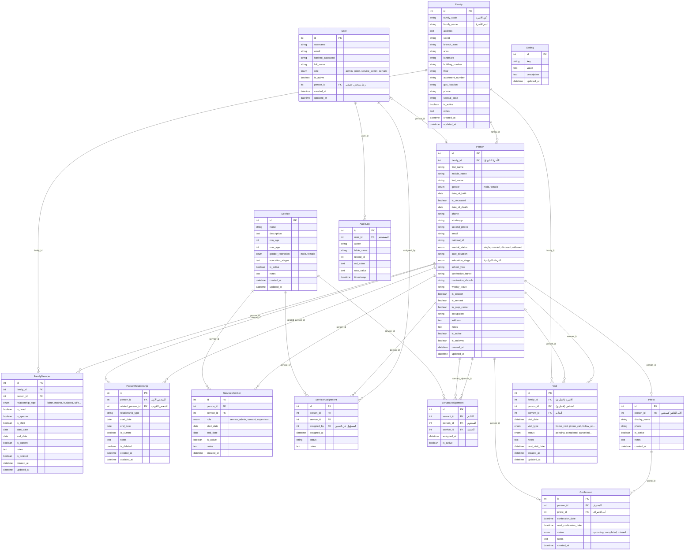

# المخطط الشامل لقاعدة البيانات (Exhaustive ER Diagram)

هذا الملف يحتوي على المخطط التفصيلي (ER Diagram) لقاعدة بيانات مشروع "كنيستي". يضم المخطط جميع الجداول، والأعمدة (الحقول)، وأنواع البيانات الخاصة بها، بالإضافة إلى توضيح العلاقات المباشرة (Relationships) بين الجداول. يمكنك استعراضه باستخدام أي محرر يدعم Markdown و Mermaid (مثل VS Code).

